# 牛马鼓励器 🐮

<p align="center">
  
</p>

<p align="center">
  <a href="https://github.com/zhew1585/wage-tick/releases"></a>
  <a href="https://github.com/zhew1585/wage-tick/releases"></a>
  <a href="https://github.com/zhew1585/wage-tick/actions/workflows/ci.yml"></a>
  <a href="https://github.com/zhew1585/wage-tick/actions/workflows/release.yml"></a>
  
  
  <a href="https://github.com/zhew1585/wage-tick/commits/main"></a>
  <a href="https://github.com/zhew1585/wage-tick/issues"></a>
</p>

一个住在 macOS 菜单栏里的小牛，按你的月薪和作息，一秒一秒地算出今天已经赚了多少钱。
上班时数字往上跳，下班时给你结算，被扣钱、请假、加班白干也都算得明明白白。
不用打卡，不连服务器，数据只存在你自己的电脑上。

---

## 快速开始

1. 到 [Releases](https://github.com/zhew1585/wage-tick/releases) 下载最新的 `WageTick-<版本>.dmg`。
2. 打开 dmg，把「牛马鼓励器」拖进「应用程序」。
3. 第一次打开要在「应用程序」里**右键它 → 打开**。App 没有苹果开发者签名，直接双击会被系统拦下，右键打开一次之后就正常了。
4. 跟着引导填月薪、休息模式（双休 / 单休 / 大小周）和上下班时间，小牛就开始在菜单栏里帮你数钱了。

装好之后 App 会自己检查更新，有新版本时在后台下载好，再问你是立即重启还是稍后自己重启，不用再手动下载。

## 功能

- **菜单栏实时数钱**：菜单栏里的小牛旁边显示今日已赚，上班时每秒跳动；也可以切成工作进度百分比，或者只显示图标。
- **今日概览**：今日已赚（4 位小数实时滚动）、工作进度条（饭点和请假会空出来）、距离下班倒计时、距离周末、本月累计，一眼看完。
- **作息随你定**：上下班时间任意设（不跨天），饭点自动放在上班时段中间，可以改也可以不要。
- **休息模式**：双休、单休、大小周三种，按月生效；法定节假日和调休自动从公开数据里拿，调休上班的周末照样算钱。
- **距离周末**：离下一个休息日还有几天，碰上春节、国庆这种法定节假日会显示「距离放假」。
- **今天扣钱了**：迟到罚款之类的扣款，按固定金额或日薪百分比记一笔，今日已赚立刻跟着变。
- **请假**：在时间条上拖出请假的那一段（10 分钟一格），扣薪比例按请掉的工时自动算，也可以手动改。
- **白干计时**：下班了还没走点「我还没走」，周末被叫去加班点「被迫营业」，按时薪算你今天倒贴了多少；可以一路计到第二天上班前。
- **攒钱队列**：给自己定几个目标（换台 Switch、去趟大理……），工资自动往里攒，显示还需几天、预计哪天达成，攒够了放烟花。
- **历史**：按月看每天赚了多少，点进某一天可以补记扣钱、请假、白干，或者改当月的月薪。
- **发薪日倒计时**：设好每月几号发工资，碰上休息日可以选提前、顺延或不变；概览页脚和菜单栏里显示还有几天发薪，当天变成「今天发薪」。
- **桌面悬浮小牛**：桌面角落站着一头小牛，举着气泡告诉你离发薪还有几天，越临近越激动，发薪当天撒花庆祝；拖到屏幕边上会收起来只探个头，全屏时自动躲开，不想要可以在设置里关掉。
- **桌面小组件**：小号、中号、大号三种尺寸，今日已赚、倒计时、距离周末和攒钱进度放在桌面上。
- **通知**：下班时告诉你今天赚了多少，目标攒够了也会提醒。
- **其他**：开机自动启动、隐藏 Dock 图标（只在菜单栏常驻）、清空数据重新开始。

## 版本与更新

- **正式版**：手动发布，App 默认只自动更新到正式版。
- **尝鲜版（nightly）**：main 上有新改动时自动发，两次之间至少隔 6 小时。在设置 → 更新里打开「接收尝鲜版」，就能第一时间用上新功能。
- 自动更新在设置里可以关掉，关掉后只在点「检查更新」时检查。

发布流程和自动更新的做法见 [ADR-0007](docs/adr/0007-github-releases-and-sparkle-updates.md)。

## 兼容性

- **系统**：macOS 14 Sonoma 及以上，Apple 芯片和 Intel 都支持（通用二进制）。
- **网络**：只在两个地方联网，一是每年拉一次法定节假日数据，二是检查更新；其余全部离线，数据存在本机 `~/Library/Application Support/com.zhew1585.WageTick/`。
- **签名**：App 用 ad-hoc 签名，没有经过苹果公证，所以第一次打开需要右键打开；之后的自动更新会校验 EdDSA 签名，不会被篡改。

## 运行效果

**今日概览**：上班中、已下班、白干中、休息日

<p>
  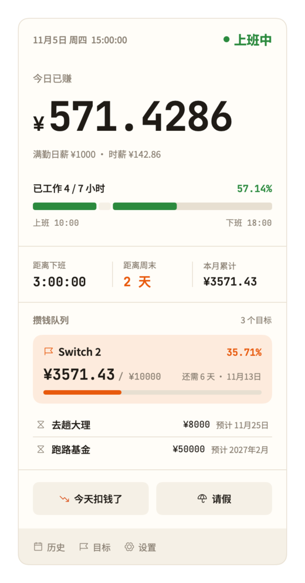
  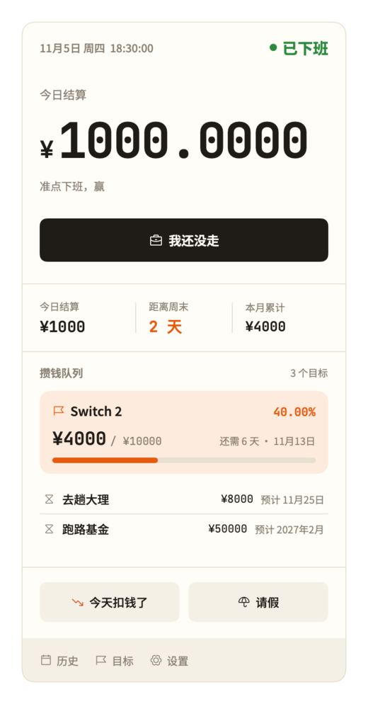
  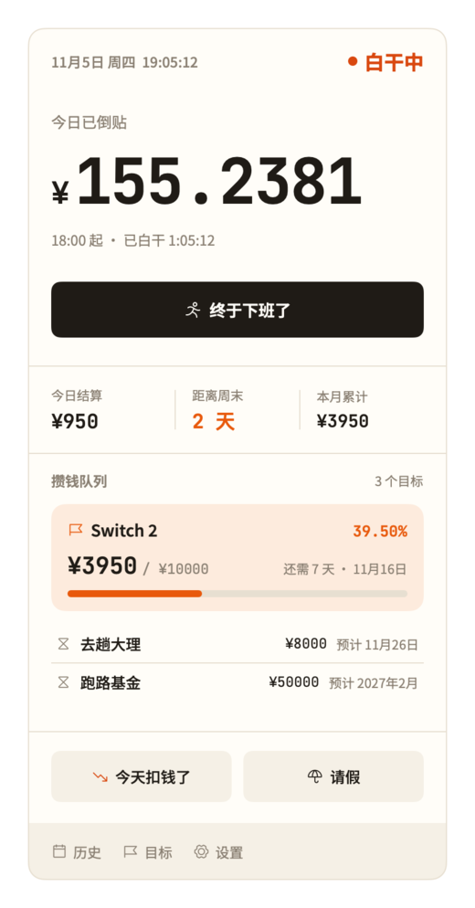
  
</p>

**扣钱、请假、攒钱队列、设置**

<p>
  
  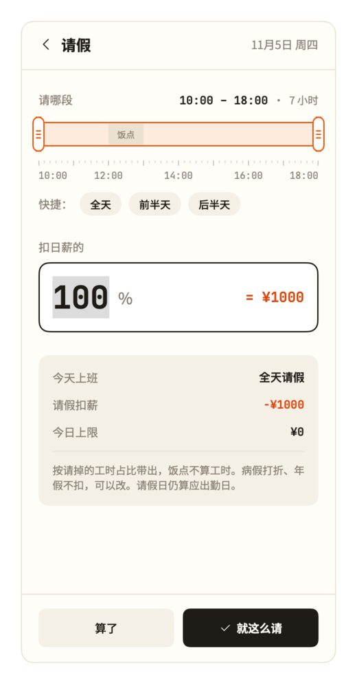
  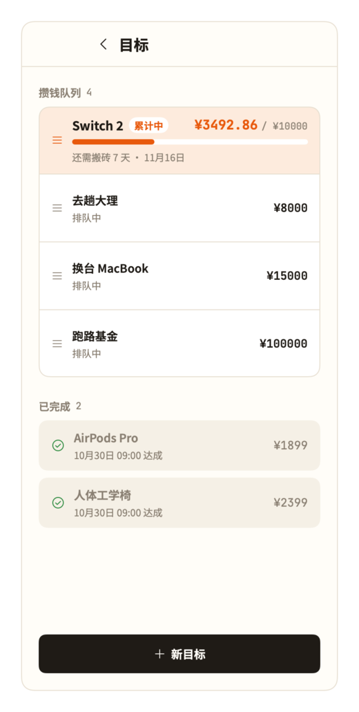
  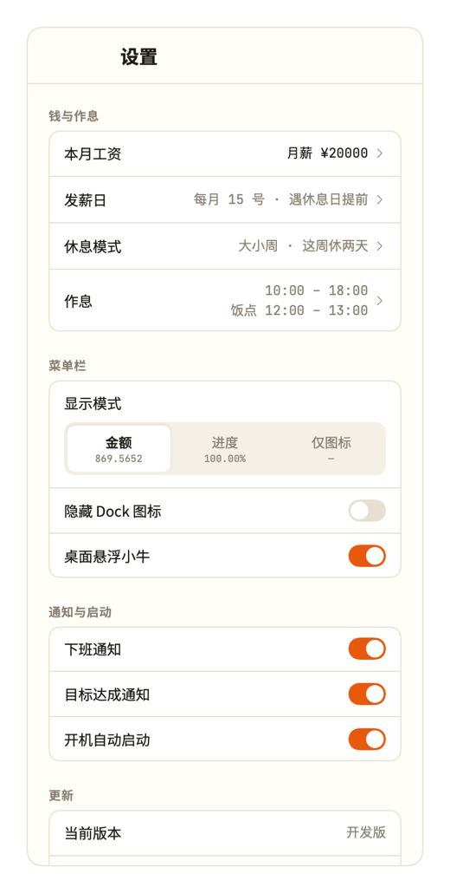
</p>

**发薪日**：距发薪倒计时、发薪当天、设置发薪日

<p>
  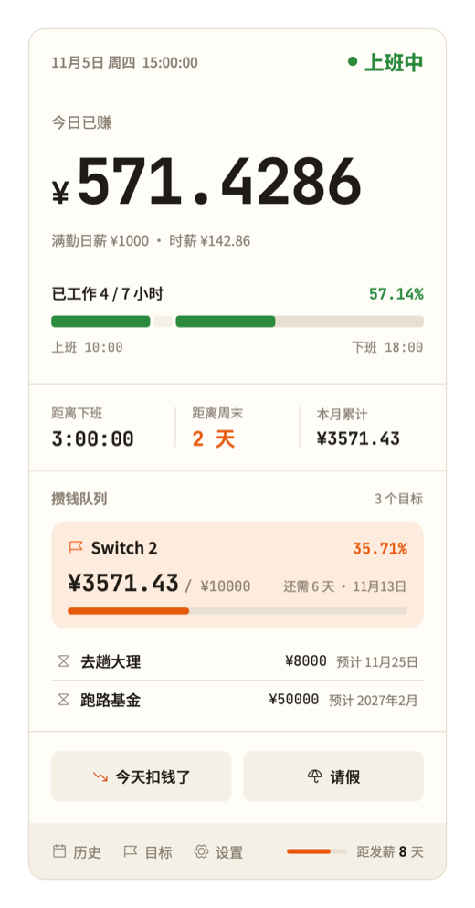
  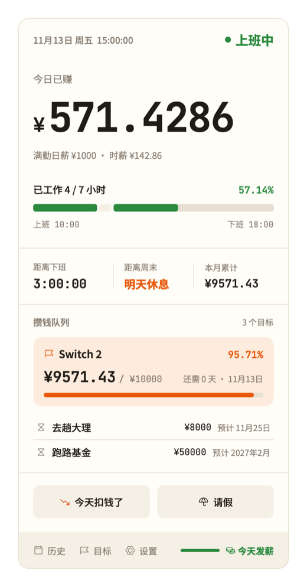
  
</p>

**桌面悬浮小牛**：距发薪几天、明天发薪、发薪当天、贴边收起

<p>
  
  
  
  
</p>

**历史**：月日历与单日详情

<p>
  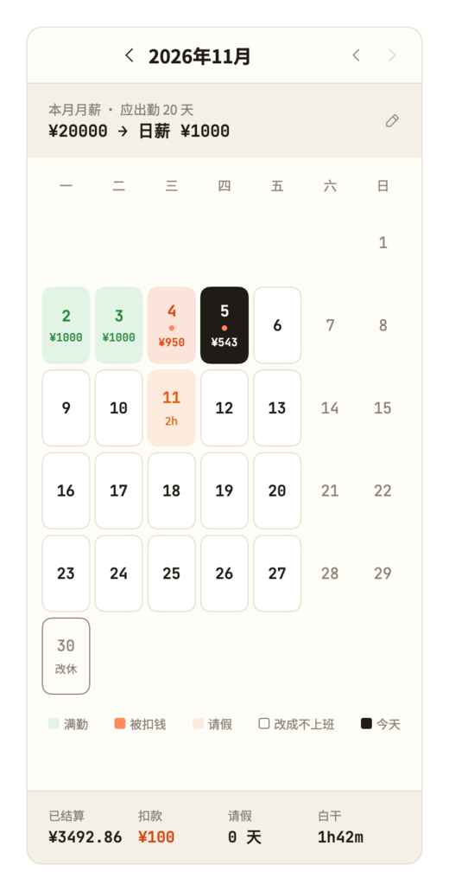
  
</p>

**桌面小组件**：小号、中号、大号

<p>
  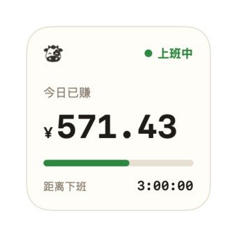
  
  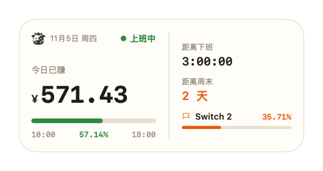
</p>
<p>
  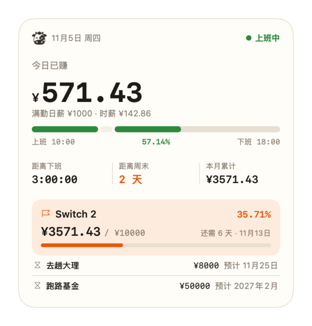
</p>

截图都由 `scripts/render-*-previews.sh` 离屏渲染，用的是假数据。

## 开发

需要 Xcode 16.4 及以上。

```bash
# 核心逻辑的测试 (WageCore，纯 Swift，不依赖界面)
swift test --package-path WageCore

# 编译 Debug 版、装进 /Applications 并启动 (桌面小组件只认 /Applications 里的 App)
scripts/run-debug.sh

# 离屏渲染各页面截图，和设计稿对照
scripts/render-panel-previews.sh
scripts/render-page-previews.sh
scripts/render-widget-previews.sh
```

项目结构：

- `WageCore/`：全部计算规则（日薪、今日已赚、请假、白干、目标、小组件时间线），带 500 多个测试。界面上显示的每一个字都由它算好，外壳只负责摆放。
- `WageTick/`：SwiftUI + AppKit 外壳（菜单栏、面板、各窗口、设置、自动更新）。
- `WageTickWidgets/`：桌面小组件扩展。
- `.github/`：CI 与发布流程。

文档：

- [PRD](docs/prd.md)：产品需求，每条规则与验收用例。
- [GLOSSARY](GLOSSARY.md)：术语表，代码和文档里的叫法以它为准。
- [ADR](docs/adr/)：架构决策记录。
