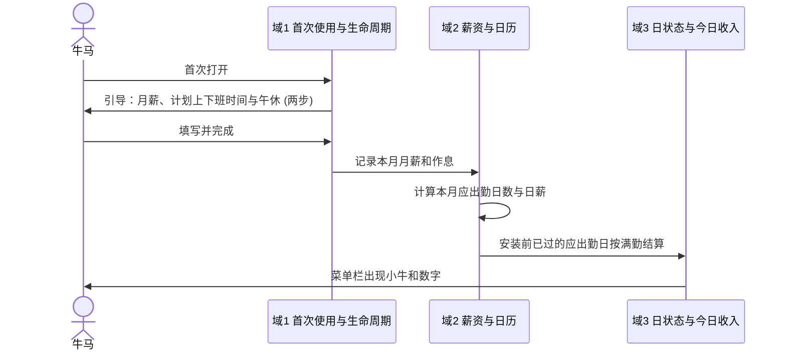
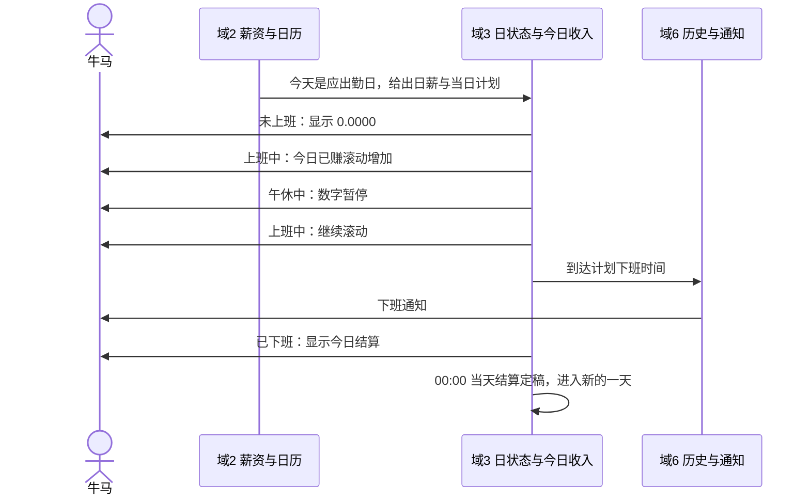
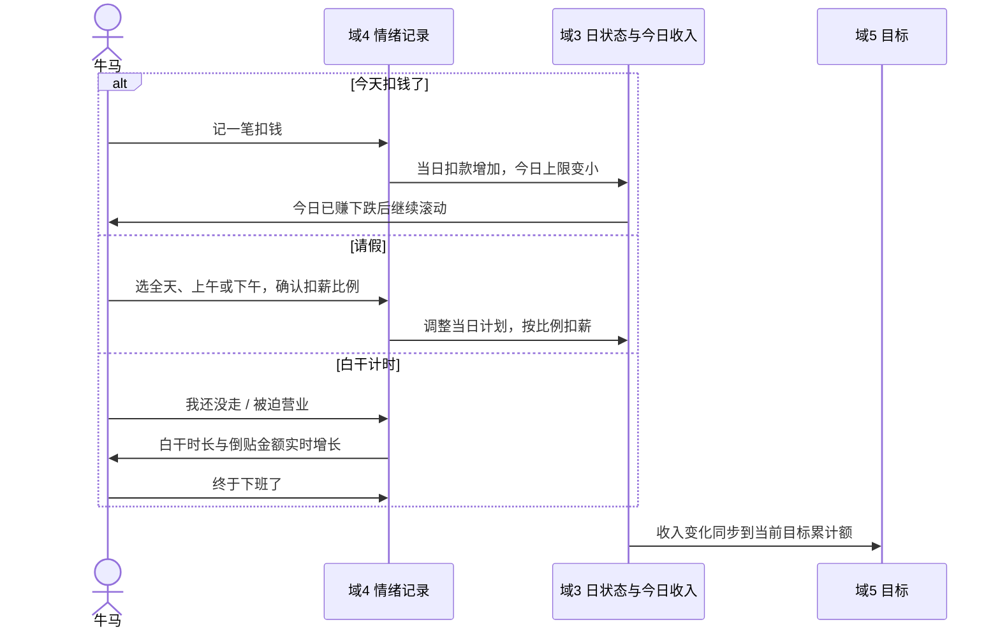
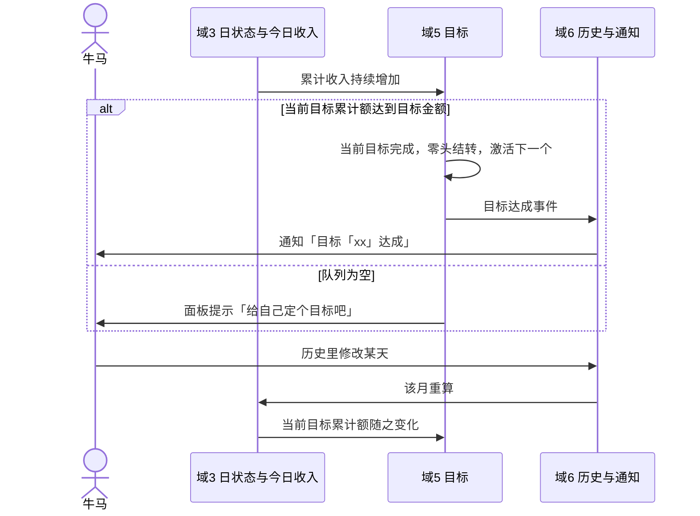
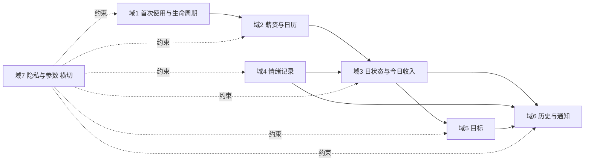

# 牛马鼓励器 PRD

# 文档信息

| **文档版本** | V1.6 | **状态** | 草稿 |
| --- | --- | --- | --- |
| **产品名称** | 牛马鼓励器 (WageTick) | **创建日期** | 2026.11.05 |
| **产品经理** | @Allen | **更新日期** | 2026.11.05 |
| **评审人** | 产品 / 研发 / 设计 | **目标上线** | 待定 |

# 修订记录

| **版本** | **日期** | **修订人** | **修订说明** |
| --- | --- | --- | --- |
| V1.0 | 2026.11.05 | @Allen | 初稿 |
| V1.1 | 2026.11.05 | @Allen | 按设计稿同步：左键菜单、请假去掉假种、数字展示规则、白干中面板、面板目标区可展开、引导合并为 3 步 |
| V1.2 | 2026.11.05 | @Allen | 定 G1、O1、O3：MVP 不做清空全部数据，老板路过默认快捷键 ⌃⌥B，面板目标区记住展开状态 |
| V1.3 | 2026.11.05 | @Allen | 改 D6：未完成目标组成攒钱队列，可整体拖动排序，第一个即累计中；换下累计中目标时已累计的钱转给新的第一个；已完成目标沉底不参与排序 |
| V1.4 | 2026.11.05 | @Allen | 今日概览统计行固定带扣款 (没有扣款时 ¥0)，首页不再列扣钱明细，明细在历史单日详情查看和编辑 |
| V1.5 | 2026.11.05 | @Allen | 改 G1：设置中提供「清空数据并重启」 |
| V1.6 | 2026.11.06 | @Allen | 按 Pencil 760 设计稿同步：引导改为 2 步 (不再询问开机自启)；面板小字、统计行「今日扣款」、休息日文案、攒钱队列直接列出 (去掉展开收起，O3 作废)；表单预览；判定来源增加「工作日」；月日历显示每日金额与月小结；时薪对外展示 |

设计稿定稿：Pencil 文件「牛马鼓励器.pen」中名字带「 · 760」的各屏 (窗口统一 360×760)。

# 一、用户与场景

## 1.1 目标用户

| **类别** | **角色** | **描述** | **核心诉求** |
| --- | --- | --- | --- |
| 外部 | 双休白领牛马 | 拿固定月薪、按固定上下班时间工作、坐在电脑前的打工人 | 随时知道"今天已经赚了多少"，给枯燥的工作日一点盼头 |
| 外部 | 开放办公区牛马 | 屏幕常被同事或领导看到的牛马 | 看自己的数字，但别人看不懂、看不出来 |
| 外部 | 有攒钱目标的牛马 | 想买 Switch、想出去旅游、想攒够跑路基金的牛马 | 把"搬砖"和"想要的东西"挂钩，知道还要熬多少天 |
| 内部 | 维护者 | 开源项目维护者 (@Allen) | 每年更新法定节假日数据，处理 GitHub issue，发布新版本 |

## 1.2 使用场景

- **核心场景**：牛马在工作日盯着菜单栏里一个一直往上跳的数字，知道今天已经赚了多少、还有多久下班。
  不做的话，牛马只能靠心算或者打开计算器，既不实时，也会被旁人看到。
- **形态枚举**：
  - 正常工作日：按计划上下班时间实时计算
  - 打折工作日：当天被扣钱或请了半天假，今日上限变小
  - 非工作日：周末、法定节假日、全天请假，不计算收入
  - 白干时段：下班后还没走，或周末被迫营业
- **典型业务场景**

| **业务场景** | **前置条件** | **动作** | **具体描述** |
| --- | --- | --- | --- |
| 上班摸鱼看钱 | 已完成首次设置，今天是应出勤日 | 瞟一眼菜单栏 | 菜单栏显示一个不带任何文字的 4 位小数，持续滚动增加 |
| 盼下班 | 当前处于上班中 | 点开菜单栏面板 | 看到距离下班倒计时、今日工作进度和本月累计 |
| 领导路过 | 任意状态 | 按下老板路过快捷键 | 菜单栏只剩一只小牛，数字消失 |
| 迟到被扣钱 | 今天是应出勤日 | 点"今天扣钱了！"，填 50 元 | 今日已赚往下掉一截，然后接着滚 |
| 请半天假 | 今天或未来某天是应出勤日 | 点"请假"，选下午 | 当天计划下班提前到午休开始，默认扣半天日薪 |
| 下班还没走 | 已过计划下班时间 | 点"我还没走"，走时点"终于下班了" | 记录白干时长和"相当于倒贴 xx 元" |
| 周末被叫去加班 | 今天是休息日 | 点"被迫营业" | 同样记录白干时长 |
| 攒钱买东西 | 已录入目标 | 打开面板看目标 | 看到进度条、"还需搬砖 N 天"和预计完成日，可展开查看排队中的目标 |
| 补记上周被扣的钱 | 历史某天是应出勤日 | 历史 → 日历 → 点那一天 → 记扣钱 | 那一天的结算和本月累计随之重算 |
| 公司临时周六补班 | 某个周六原本是休息日 | 历史日历里把那天改成上班日 | 本月应出勤日数 +1，整月日薪随之重算 |

# 二、背景与目标

## 2.1 背景与痛点

### 2.1.1 背景

牛马们现在大概有三种方式感知"今天赚了多少"：
- 心算或者用计算器，把月薪除一除
- 用网页或小程序上的"工资计算器"，输入月薪得到日薪、时薪
- 刷社交平台上"你今天已经赚了 xx 元"一类的段子和表情包，图一乐

### 2.1.2 痛点

**不实时**：心算和计算器都只能得到一个静态数字，感受不到钱"正在进账"。

**算不准**：大多数计算器按每月 21.75 天或固定 22 天算，不考虑法定节假日和调休，满勤一个月也对不上月薪。

**不隐私**：打开网页、小程序或手机计算器，屏幕上明晃晃写着"工资"二字，旁人一眼就懂。

**没有情绪出口**：被扣钱、加班、请假这些真正让牛马破防的时刻，没有地方吐槽和记一笔。

**没有盼头**：知道日薪是多少，却不知道离"想买的那个东西"还有多远。

### 2.1.3 小结

现有方式要么只给一个静态数字，要么不准，要么暴露隐私，都没有把"实时进账感"、"隐私"和"情绪价值"放在一起。
我们要做的不是考勤或记账工具，而是一个常驻菜单栏、只有自己看得懂的"实时进账"小玩具，外加几个让牛马发泄和期待的情绪按钮。

## 2.2 目标

以 macOS 菜单栏为切入点，只需要月薪和上下班时间两项配置，不打卡、不记账、零负担。
用按当月应出勤日精确计算的日薪，换来"满勤正好等于月薪"的可信感。
牛马得到的是一个一直在跳的数字、一个下班倒计时、一个攒钱目标，以及被扣钱和加班时的一句吐槽。

## 2.3 成功指标

产品不做任何使用数据上报 (见 4.7.1)，指标只取公开渠道数据。

| **指标** | **目标值** | **衡量方式** |
| --- | --- | --- |
| 安装包下载量 | 首个正式版发布后 90 天内累计 ≥ 1000 次 | GitHub Releases 下载计数 |
| Homebrew 安装量 | 首个正式版发布后 90 天内 ≥ 300 次 | Homebrew cask 公开安装统计 |
| 社区认可 | 首个正式版发布后 90 天内 GitHub Star ≥ 500 | GitHub 仓库 Star 数 |
| 计算正确性 | 本 PRD 所有算例和 AC 用例发布前 100% 通过；上线后计算错误类 issue 7 天内修复 | 发布前验收记录；GitHub issue 标签与关闭时间 |

# 三、需求范围与概述

## 3.1 本期范围（In Scope）

| **编号** | **需求** | **优先级** | **实现方式** |
| --- | --- | --- | --- |
| R1 | 按当月应出勤日计算日薪，满勤等于月薪 | P0 | 应出勤日 = 双休 + 法定节假日与调休 + 单日覆盖，见 4.2 |
| R2 | 今日已赚实时计算并持续滚动 | P0 | 按计划上下班时间和午休推进工作进度，见 4.3 |
| R3 | 菜单栏常驻显示，不出现任何说明文字 | P0 | 状态动画小牛 + 4 位小数，见 4.7.1 |
| R4 | 老板路过模式 | P0 | 快捷键一键隐藏数字，见 4.7.1 |
| R5 | 面板展示日期时间、日状态、今日已赚、工作进度、下班倒计时、本月累计 | P0 | 点击菜单栏展开，见 5.1.3 |
| R6 | 首次使用引导 | P0 | 两步：月薪；上下班时间与午休。开机自启默认开，见 4.1 |
| R7 | 今天扣钱了 | P0 | 手动记一笔扣钱，按元或日薪百分比，见 4.4.1 |
| R8 | 请假 | P1 | 全天、上午、下午，按日薪百分比扣薪，见 4.4.2 |
| R9 | 白干计时 | P1 | 下班后"我还没走"，休息日"被迫营业"，见 4.4.3 |
| R10 | 目标队列 | P1 | 牛马自己录入长期收入目标，依次累计；面板默认展示累计中目标，可展开，见 4.5、F9 |
| R11 | 历史月份 | P1 | 月列表 + 日历，每一天都可查看和编辑，见 4.6.1 |
| R12 | 下班通知与目标达成通知 | P1 | 系统通知，老板路过模式下不带金额，见 4.6.2 |
| R13 | 法定节假日数据 | P0 | 内置当年数据，每年从公开数据源获取新一年数据，见 6.4 |
| R14 | 左键菜单 | P0 | 左键点击菜单栏小牛弹出菜单，所有入口集中于此，见 F2 |

## 3.2 不做的部分（Out of Scope）

| **编号** | **描述** |
| --- | --- |
| 1 | 打卡。产品不记录实际上下班时刻，所有计算只按计划上下班时间 (ADR-0003) |
| 2 | 弹性工作制。没有打卡，"下班时间 = 上班打卡 + 标准工时"不成立 |
| 3 | 迟到早退的自动判定和扣款规则表。扣钱一律由牛马手动记录 |
| 4 | 税费、社保、公积金换算。月薪填什么就按什么算 |
| 5 | 人民币以外的货币 |
| 6 | 跨零点班次 (夜班)。计划下班时间最晚 23:59 |
| 7 | 账号体系、云端存储、多设备同步 (ADR-0002) |
| 8 | 任何使用数据上报 |
| 9 | 安装当月之前的历史月份。历史从安装当月开始 |
| 10 | macOS 以外的平台 |

## 3.3 未来会做的部分（In Future）

| **编号** | **业务名** | **典型业务场景** | **可能涉及的业务域** | **预计启动时间** |
| --- | --- | --- | --- | --- |
| 1 | iOS App | 通勤路上在手机上看今日已赚和目标 | 全部 | MVP 发布后 |
| 2 | 多设备同步 | Mac 上记的扣钱，手机上也能看到 | 域4、域5、域6 | 与 iOS App 同期 |
| 3 | 单休、大小周 | 非双休的牛马也能算准应出勤日 | 域2 | 待定 |
| 4 | 跨零点班次 | 夜班牛马 | 域2、域3 | 待定 |
| 5 | 税前转到手 | 只知道税前月薪的牛马估算到手 | 域2 | 待定 |
| 6 | 加班费 | 白干时长按倍率计薪，不再只是吐槽 | 域3、域4 | 待定 |
| 7 | 成就系统 | 连续满勤、本月零扣钱等 | 域4、域6 | 待定 |
| 8 | 分享卡片 | 把今日已赚、本月白干时长生成图片发朋友圈 | 域6 | 待定 |

## 3.4 业务流概览

| **阶段** | **时序图** |
| --- | --- |
| 阶段一：首次使用 | 见下方图 1 |
| 阶段二：工作日的一天 | 见下方图 2 |
| 阶段三：情绪记录 | 见下方图 3 |
| 阶段四：结算与目标 | 见下方图 4 |

**图 1 阶段一：首次使用**

**图 2 阶段二：工作日的一天**

**图 3 阶段三：情绪记录**

**图 4 阶段四：结算与目标**

# 四、领域规则

本章按 7 个功能域组织，是本产品全部业务规则的唯一出处。
域 1 到域 6 沿牛马使用产品的过程展开，域 7 为横切基座，约束所有域。
第五章、测试用例均以本章为准。
本章与其他任何位置表述不一致时，以本章为准并回改其他位置。
术语以仓库根目录 `GLOSSARY.md` 为准。

## 4.1 首次使用与生命周期

### 4.1.1 首次使用

- **开放模式**：免费开源，任何人可下载使用，无账号、无激活。
- **开通流程**：首次打开时进入引导，共两步：
  1. 月薪 (必填)
  2. 计划上下班时间 (默认 09:00 至 18:00) 与午休 (默认 12:00 至 13:00，可关闭)；下方「按这个作息算」展示本月上班日 (即应出勤日数)、满勤日薪、标准工时、时薪，主按钮「开始搬砖」完成引导
- 引导不询问开机自动启动，完成时按默认值 (开) 注册，之后可在设置中修改。
- 完成引导后直接打开今日概览，出现在引导窗口原来的位置。
- 引导完成前，菜单栏不显示数字，点击菜单栏重新打开引导。
- 引导中填写的月薪作为安装当月的月薪 (4.2.1)。
- **安装前的日子**：安装当月、安装日之前已经过去的应出勤日，一律按满勤结算 (4.3.4)，第一天打开就能看到本月累计。
- **历史起点**：历史从安装当月开始，不存在更早的月份。
- **卸载**：卸载产品时数据留在本机，重新安装后可继续使用。
- **收费方式**：免费。

### 4.1.2 清空数据【G1】

- 设置中提供「清空数据并重启」，需二次确认。
- 确认后清空月薪、作息、扣钱、请假、白干、目标和界面偏好，App 重启后回到首次使用引导。
- 上一份数据在本机留一份备份 (只保留最近一份)；节假日数据缓存保留。

### 4.1.3 使用状态与入口呈现

| **状态阶梯** | **菜单栏** | **面板** | **可用行为** |
| --- | --- | --- | --- |
| 未完成引导 | 只显示小牛，无数字 | 显示引导 | 完成引导 |
| 已完成引导 | 小牛 + 数字 (按显示模式，见 4.7.1)，左键点击弹出菜单 (F2) | 完整功能 | 全部 |

## 4.2 薪资与日历

### 4.2.1 月薪

**背景**：月薪是一切计算的源头，每个月可能不同 (涨薪、降薪、换工作)。

**定义**：牛马自己填写的每月固定收入，口径 (税前或到手) 由牛马决定。

**领域模型字段**

| **字段名称** | **数据类型** | **含义与设计要点** |
| --- | --- | --- |
| 月份 | 年月 | 每个月一条 |
| 金额 | 金额 (元，最多 2 位小数) | 必须大于 0 |

**业务规则**：
1. 修改月薪，对当前月份整月生效，包括本月已经过去的日子。
2. 已经过去的月份保留当时的月薪，不受修改影响。历史月份的月薪只能在该月的历史页修改。
3. 未来月份沿用最近一次设置的月薪。
4. 产品不做任何税费换算。

### 4.2.2 应出勤日

**背景**：只按周一到周五算，会被法定节假日和调休坑到，满勤对不上月薪。

**定义**：某个月里牛马需要上班的日子。

**领域模型字段**

| **字段名称** | **数据类型** | **含义与设计要点** |
| --- | --- | --- |
| 日期 | 日期 | |
| 是否应出勤 | 是 / 否 | 按下方判定顺序得出 |
| 判定来源 | 枚举：工作日 / 双休 / 法定节假日 / 调休上班 / 单日覆盖 | 历史日历中展示，方便牛马理解。工作日即按规则应出勤的周一至周五，双休只用于周六周日 |

**判定顺序** (先命中者为准)：
1. 单日覆盖：牛马手动改成上班日或不上班日
2. 调休上班日：应出勤
3. 法定节假日：不应出勤
4. 周六、周日：不应出勤
5. 其余：应出勤

**单日覆盖规则**：
- 可以对任意日期设置，包括过去和未来。
- 可以撤销，撤销后回到按规则判定。
- 覆盖会改变当月应出勤日数，从而改变当月日薪 (4.2.4)，当月所有结算随之重算。

**节假日数据**：内置当年数据，每年获取新一年数据，获取失败的兜底见 4.3.5 #10 和 6.4。

**请假与应出勤**：请假的日子仍然是应出勤日，计入应出勤日数，只按比例扣薪 (4.4.2)。

### 4.2.3 作息

**定义**：牛马配置的每天计划上下班时间与午休，是计算一天收入和进度的唯一时间依据。

**领域模型字段**

| **字段名称** | **数据类型** | **含义与设计要点** |
| --- | --- | --- |
| 计划上班时间 | 时刻 (精确到分) | 默认 09:00 |
| 计划下班时间 | 时刻 (精确到分) | 默认 18:00，必须晚于计划上班时间，最晚 23:59 |
| 午休开关 | 是 / 否 | 默认开 |
| 午休开始、午休结束 | 时刻 (精确到分) | 默认 12:00、13:00，必须落在上下班时间之内 |
| 标准工时 | 时长 (派生) | = 计划下班 - 计划上班 - 午休时长 |

**业务规则**：
1. 作息对所有应出勤日相同，不支持按星期或按日单独设置 (半天假除外，见 4.4.2)。
2. 修改作息从今天起生效，今天的进度按新作息立即重算。
3. 作息不影响结算金额 (结算只看日薪和当日扣款)，只影响进度、倒计时和白干倒贴金额。
4. 关闭午休时，计划上下班时间之间全部计入有效工时。

### 4.2.4 日薪

**定义**：当月月薪 ÷ 当月应出勤日数，满勤一天可得的金额 (ADR-0001)。

**业务规则**：
1. 日薪按月计算，同一个月内每天相同，不同月份可能不同。
2. 当月月薪或当月应出勤日数变化时，日薪立即重算，当月全部结算随之重算。
3. 当月应出勤日数为 0 时，日薪不存在，见 4.3.5 #19。
4. 日薪在计算中保留完整精度，展示格式见 4.7.1 第 5 条。

**时薪**：日薪 ÷ 标准工时，用于白干倒贴金额 (4.4.3)，并在引导与今日概览中展示。标准工时展示时保留 1 位小数。

**算例** (后文统称"标准算例")：
- 月薪 20000 元，当月应出勤日 20 天
- 作息 10:00 至 18:00，午休 12:00 至 13:00，标准工时 7 小时
- 日薪 = 20000 ÷ 20 = 1000.0000 元
- 时薪 = 1000 ÷ 7 = 142.8571 元
- 每秒约 1000 ÷ 25200 = 0.0397 元
- 当月临时把一个周六改成上班日：应出勤日 21 天，日薪 = 20000 ÷ 21 = 952.3810 元，当月已结算的满勤日全部变为 952.3810 元

## 4.3 日状态与今日收入

### 4.3.1 对象模型

一天对应一条日记录。
日记录只保存牛马手动产生的内容 (扣钱记录、请假、白干段、单日覆盖)，日薪、当日计划、状态、收入全部由规则实时推导，不单独保存。

#### 日记录

_1. 标识_

| **字段（业务名）** | **说明** | **示例 / 取值** |
| --- | --- | --- |
| 日期 | 一天一条 | 2026.11.05 |

_2. 牛马录入的内容_

| **字段（业务名）** | **说明** | **示例 / 取值** |
| --- | --- | --- |
| 单日覆盖 | 见 4.2.2 | 无 / 上班日 / 不上班日 |
| 请假 | 见 4.4.2 | 无 / 全天 / 上午 / 下午，及扣薪比例 |
| 扣钱记录 | 1:N，见 4.4.1 | 迟到 50 元 |
| 白干段 | 1:N，见 4.4.3 | 18:20 至 20:05 |

_3. 推导内容_

| **字段（业务名）** | **说明** | **示例 / 取值** |
| --- | --- | --- |
| 是否应出勤 | 4.2.2 | 是 |
| 当日计划上班、计划下班 | 作息经半天假调整后的结果 | 10:00、18:00 |
| 当日应有有效工时 | 当日计划上下班之间扣除午休 | 7 小时 |
| 当日扣款 | 扣钱记录合计 + 请假扣薪 | 50 元 |
| 今日上限 | 日薪 - 当日扣款，下限 0【D1】 | 950 元 |
| 结算 | 当天结束后的最终收入，等于今日上限 | 950 元 |
| 白干时长 | 白干段合计 | 1 小时 45 分 |

### 4.3.2 当日计划的生成

1. 判定今天是否应出勤 (4.2.2)。
2. 不应出勤：日状态为休息日，不生成计划，不产生收入。
3. 应出勤且全天请假：日状态按休息日呈现【D2】，收入为今日上限 (按扣薪比例，可能为 0)，不滚动。
4. 应出勤且半天请假：按 4.4.2 调整当日计划上班或计划下班。
5. 其余：当日计划 = 作息。

### 4.3.3 日状态与进度

**不变量（优先于一切规则）**：

1. 日状态只由当前时刻、是否应出勤、当日计划决定，与牛马实际在不在公司无关。
2. 白干计时不改变日状态，也不改变任何收入。
3. 今日已赚只在上班中增长，在一天内不会因时间推移而减少 (只会因牛马记扣钱而下跌)。

**主状态概览**

| **主状态** | **是否终态** | **含义** | **菜单栏小牛** |
| --- | --- | --- | --- |
| 休息日 | 是 | 今天不应出勤，或全天请假 | 晒太阳 |
| 未上班 | 否 | 应出勤日，还没到当日计划上班 | 打哈欠 |
| 上班中 | 否 | 当日计划上下班之间，且不在午休 | 埋头拉磨 |
| 午休中 | 否 | 午休时段内 | 趴着睡 |
| 已下班 | 是 (当天) | 已过当日计划下班 | 躺平 |

白干计时进行中时，小牛在原状态基础上显示"边拉磨边冒汗"。
面板状态标签显示「白干中」，这只是展示，不是新的日状态 (不变量 2)。

**状态流转明细**

| **主状态** | **进入条件** | **今日已赚** | **主要后继** |
| --- | --- | --- | --- |
| 未上班 | 00:00 起，今天应出勤 | 0 | 上班中 |
| 上班中 | 到达当日计划上班，或午休结束 | 滚动增长 | 午休中、已下班 |
| 午休中 | 到达午休开始 | 暂停 | 上班中 |
| 已下班 | 到达当日计划下班 | 等于今日上限，不动 | 次日 00:00 |
| 休息日 | 00:00 起，今天不应出勤或全天请假 | 不显示 | 次日 00:00 |

半天假的状态差异：
- 上午假：午休结束前为未上班，之后为上班中，不经过午休中。
- 下午假：午休开始即为已下班。

单日覆盖或请假在当天中途修改时，状态按新计划立即重新推导 (4.3.5 #18)。

**终态与非终态汇总**：当天终态 = 已下班、休息日；非终态 = 未上班、上班中、午休中。每天 00:00 重新开始。

### 4.3.4 收入计算

**工作进度** = 当日已过有效工时 ÷ 当日应有有效工时。
上班前为 0，下班后为 100%，午休时段不计入已过有效工时。

**今日已赚** = 今日上限 × 工作进度。

**今日上限** = 日薪 - 当日扣款，最低为 0【D1】。

**结算**：每个应出勤日 24:00 时结算定稿，结算 = 今日上限。
没有任何情绪记录的应出勤日，结算 = 日薪 (满勤)。
日薪或当日扣款事后变化时，结算随之重算。

**本月累计** = 本月今天之前所有应出勤日的结算之和 + 今日已赚 (今天是应出勤日时)。
未来日子不计入。

**下班倒计时** = 当日计划下班 - 当前时刻，只在未上班、上班中、午休中展示。

**算例** (沿用 4.2.4 标准算例)：

| **时刻** | **场景** | **已过有效工时** | **工作进度** | **今日上限** | **今日已赚** |
| --- | --- | --- | --- | --- | --- |
| 09:30 | 未上班 | 0 | 0% | 1000 | 0.0000 |
| 11:00 | 上班中 | 1 小时 | 14.29% | 1000 | 142.8571 |
| 12:30 | 午休中 | 2 小时 | 28.57% | 1000 | 285.7143 |
| 15:00 | 上班中 | 4 小时 | 57.14% | 1000 | 571.4286 |
| 15:00 | 刚记扣钱 50 元 | 4 小时 | 57.14% | 950 | 542.8571 |
| 18:00 | 已下班 (有扣钱) | 7 小时 | 100% | 950 | 950.0000 |

本月累计算例：当月前 9 个应出勤日均满勤，今天 15:00 且有扣钱 50 元，本月累计 = 9 × 1000 + 542.8571 = 9542.8571 元。

### 4.3.5 异常处置

**异常总表**

_阶段一：配置与录入校验_

| **#** | **场景** | **处理** | **结果/状态** |
| --- | --- | --- | --- |
| 1 | 月薪为空、为 0 或负数 | 提示「月薪得是个正数」 | 不保存（阻断） |
| 2 | 计划下班不晚于计划上班 | 提示「下班时间要晚于上班时间」 | 不保存（阻断） |
| 3 | 午休不在上下班时间之内，或午休结束不晚于午休开始 | 提示「午休要在上下班时间之内」 | 不保存（阻断） |
| 4 | 计划下班选到 23:59 之后 | 控件不提供该选项 | 不可选 |
| 5 | 扣钱金额为空、为 0 或负数 | 提示「扣钱金额得大于 0」 | 不保存（阻断） |
| 6 | 扣钱后当日扣款超过日薪 | 允许保存，提示「今天已经白干了，再扣就倒贴了」 | 今日上限为 0【D1】 |
| 7 | 给未来日期记扣钱 | 日期控件不提供未来日期 | 不可选 |
| 8 | 给不应出勤的日子记扣钱或请假 | 入口不可用，提示「今天本来就不上班」 | 不可操作 |
| 9 | 目标名称为空或超过 20 个字，或目标金额不大于 0 | 提示「给目标起个名字，金额得大于 0」 | 不保存（阻断） |
| 22 | 请假扣薪比例为空、小于 0% 或大于 100% | 提示「扣薪比例要在 0% 到 100% 之间」 | 不保存（阻断） |

_阶段二：运行中_

| **#** | **场景** | **处理** | **结果/状态** |
| --- | --- | --- | --- |
| 10 | 当年法定节假日数据缺失且获取失败 | 该年按双休计算，面板顶部提示「{年份}年的节假日数据没拿到，调休日请在日历里手动标记」，之后自动重试 | 计算继续 |
| 11 | 系统时间被修改或切换时区 | 按系统当前时间重新推导状态与收入，不追溯修正 | 计算继续 |
| 12 | 白干计时到 23:59:59 仍未停止 | 自动停止，当天标记「疑似通宵」 | 白干段结束 |
| 13 | 白干计时中产品退出或电脑睡眠 | 计时按开始时刻继续，重新打开后照常显示 | 计时继续 |
| 14 | 电脑睡眠或产品未运行一段时间 | 恢复后按当前时刻重新推导，收入没有缺口 | 计算继续 |
| 15 | 系统通知权限被拒 | 不发通知，设置页提示「通知被关了，去系统设置里打开」 | 其余功能不受影响 |
| 16 | 修改月薪、单日覆盖或节假日数据更新导致日薪变化 | 当月全部结算重算，当前目标累计额随之变化 | 计算继续 |
| 17 | 编辑历史导致当前目标累计额为负 | 进度显示为 0 | 目标保持累计中 |
| 18 | 上班中途把今天改成不上班日或全天请假 | 状态立即变为休息日，今日已赚按新规则重算 | 休息日 |
| 19 | 当月应出勤日数为 0 (全部被覆盖为不上班) | 不计算日薪，本月累计为 0，面板提示「本月没有要上班的日子」 | 无收入 |
| 20 | 关闭午休时请半天假 | 以当日计划上下班时间的中点为分界 | 按中点切分 |
| 21 | 同一天先后请了上午假和下午假 | 自动合并为全天假，扣薪比例为两次之和，最高 100% | 全天请假 |

**人工介入边界**：本产品没有后台，没有人工介入。节假日数据由维护者每年更新，见 6.2。

## 4.4 情绪记录

### 4.4.1 扣钱记录

**背景**：产品不判定迟到早退 (ADR-0003)，被扣了多少钱牛马自己最清楚，产品只负责记账和吐槽。

**定义**：牛马自己手动记下的一笔当天被扣的钱。

**领域模型字段**

| **字段名称** | **数据类型** | **含义与设计要点** |
| --- | --- | --- |
| 日期 | 日期 | 今天或过去的应出勤日 |
| 记账方式 | 枚举：按金额 / 按日薪百分比 | |
| 数值 | 金额 (元) 或 比例 (%) | 必须大于 0 |
| 原因标签 | 枚举：迟到 / 早退 / 其他，可不选 | 只用于展示 |
| 备注 | 文本，最多 50 字，可不填 | |

**业务规则**：
1. 一天可以记多笔，可以编辑和删除。
2. 按日薪百分比记的扣钱，金额 = 当日所在月日薪 × 比例，日薪变化时随之重算。
3. 记一笔后，今日上限立即变小，今日已赚按新上限重算并下跌，然后继续滚动。
4. 表单确认按钮文案为「继续搬砖」，不再单独展示吐槽文案。

### 4.4.2 请假

**定义**：牛马把某个应出勤日的全天、上午或下午标记为不上班，并按填写的扣薪比例扣减当天收入。
不区分假种，病假打折、年假不扣，都通过调整扣薪比例表达【D8】。

**领域模型字段**

| **字段名称** | **数据类型** | **含义与设计要点** |
| --- | --- | --- |
| 日期 | 日期 | 任意应出勤日，包括未来 |
| 时段 | 枚举：全天 / 上午 / 下午 | |
| 扣薪比例 | 百分比 (日薪的 %) | 全天默认 100%，半天默认 50%，可改为 0% 至 100% 任意值【D8】 |

**业务规则**：
1. 请假扣薪 = 日薪 × 扣薪比例。
   切换时段时带出默认值 (全天 100%、半天 50%)，牛马可再修改【D4】。
2. 半天假以午休为分界：
   - 上午假：当日计划上班改为午休结束
   - 下午假：当日计划下班改为午休开始
   - 关闭午休时以计划上下班中点为分界 (4.3.5 #20)
3. 请假日仍计入应出勤日数 (4.2.2)。
4. 同一天只能有一条请假，上午和下午合并为全天 (4.3.5 #21)。
5. 可以编辑和撤销，撤销后当天恢复为普通应出勤日。

**算例** (标准算例，下午请假)：
- 当日计划 10:00 至 12:00，应有有效工时 2 小时
- 扣薪比例取默认 50%，请假扣薪 = 1000 × 50% = 500 元，今日上限 = 500 元
- 11:00 时工作进度 50%，今日已赚 = 250.0000 元；12:00 起为已下班，结算 500 元

### 4.4.3 白干计时

**定义**：牛马在计划下班之后 ("我还没走") 或休息日 ("被迫营业") 自愿计时记录的额外工作时长，不产生收入，只用于吐槽。

**领域模型字段**

| **字段名称** | **数据类型** | **含义与设计要点** |
| --- | --- | --- |
| 日期 | 日期 | |
| 开始时刻、结束时刻 | 时刻 | 计时中时结束时刻为空 |
| 疑似通宵 | 是 / 否 | 被自动停止时为是 |

**业务规则**：
1. "我还没走"只在应出勤日的已下班状态可用；"被迫营业"只在休息日可用。
2. 同一时间只能有一段计时。一天可以有多段，白干时长为各段之和。
3. 计时到 23:59:59 自动停止并标记疑似通宵 (4.3.5 #12)。
4. 倒贴金额 = 白干时长 × 时薪 (4.2.4)，时薪按作息的标准工时计算，不受半天假影响。
5. 白干段可在历史中补记、修改、删除。
6. 当天没有白干记录时，已下班状态展示「准点下班，赢」。

**算例** (标准算例)：18:00 至 19:30 白干 1.5 小时，倒贴 = 1.5 × 142.8571 = 214.2857 元。

## 4.5 目标

### 4.5.1 目标对象

**背景**：知道日薪不够有盼头，牛马需要把搬砖和想要的东西挂钩。

**定义**：牛马自己录入的长期收入目标 (名称和金额)，从激活那一刻起累计收入，达到即完成，然后自动激活队列里的下一个目标。

**领域模型字段**

| **字段名称** | **数据类型** | **含义与设计要点** |
| --- | --- | --- |
| 名称 | 文本，1 至 20 字 | 例如「Switch 2」 |
| 金额 | 金额 (元) | 大于 0 |
| 状态 | 枚举：排队中 / 累计中 / 已完成 | |
| 起算基准 | 金额 (派生) | 激活时的累计收入，用于计算累计额 |
| 完成时间 | 时刻 | 仅已完成 |

**累计收入**：从安装当月起，所有已结算应出勤日的结算之和 + 今日已赚。

### 4.5.2 状态与累计规则

**不变量**：
1. 同一时间最多一个目标处于累计中。
2. 每一分钱只计入一个目标。
3. 已完成的目标冻结，不受任何后续编辑影响。

**累计额** = 累计收入 - 起算基准。

| **事件** | **规则** |
| --- | --- |
| 队列为空时新建目标 | 直接成为累计中，起算基准 = 此刻累计收入，不追溯之前赚的钱 |
| 已有累计中目标时新建 | 加入队尾，状态排队中 |
| 累计额达到目标金额 | 当前目标完成，记录完成时间；下一个排队目标成为累计中，起算基准 = 上一个的起算基准 + 上一个的金额 (超出零头自动结转) |
| 完成时队列为空 | 零头不保留；之后新建的目标从新建时刻起算 |
| 编辑历史 (扣钱、请假、覆盖、月薪) | 只影响当前累计中目标的累计额 |
| 删除累计中目标 | 下一个排队目标成为累计中，继承被删目标的起算基准，已累计的钱不丢【D5】 |
| 调整顺序 | 攒钱队列 (累计中 + 排队中) 内可任意调整顺序，队列第一个即累计中。第一个换人时，新的第一个成为累计中并继承原累计中目标的起算基准 (已累计的钱转过去)，原累计中目标退回排队中，下次激活时重新起算；继承后累计额已达标的立即完成，零头照常结转【D6】。已完成目标不参与排序 |
| 编辑目标 | 排队中和累计中的目标可改名称和金额；改小金额导致累计额已达标时立即完成 |

### 4.5.3 预计完成

1. 剩余金额 = 目标金额 - 累计额。
2. 今天是应出勤日且未下班时，先扣除今日剩余可赚 (今日上限 - 今日已赚)。扣除后不大于 0，展示「今天就能达成」。
3. 否则 N = 剩余金额 ÷ 当月日薪，向上取整，从明天起数第 N 个应出勤日为预计完成日。跨月时仍按当月日薪估算【D7】。
4. 展示「还需搬砖 N 天 · M月D日」。
5. 排队中目标：从前一个目标的预计完成日之后起，按当月日薪数 ceil(目标金额 ÷ 日薪) 个应出勤日，作为预计完成日，展示「排队中 · 预计 M月D日」；不在今年时展示「排队中 · 预计 YYYY年M月」【D7】。

**算例** (标准算例)：目标 10000 元，今天 15:00 累计额 3000 元，今日已赚 571.4286 元。
今日剩余可赚 = 1000 - 571.4286 = 428.5714 元。
剩余 = 10000 - 3000 - 428.5714 = 6571.4286 元，N = 6571.4286 ÷ 1000 向上取整 = 7。
展示「还需搬砖 7 天」，预计完成日为明天起第 7 个应出勤日。

## 4.6 历史与通知

### 4.6.1 历史月份

- **查询范围**：安装当月至今的每个月。
- **月汇总**：每月展示结算总额、应出勤日数、扣款合计、请假天数 (半天计 0.5)、白干时长合计 (展示标题为「应出勤 / 扣款 / 请假 / 白干」，扣款用 loss 色、不带负号，白干时长写成「1h42m」)。本月标「本月 · 进行中」，安装当月标「安装当月」。
  结算总额 = 当月各应出勤日结算之和；当月为本月时等于本月累计。
- **日历视图**：用颜色标出每一天的类型：满勤、被扣钱、请假、改成不上班 (单日覆盖为不上班)、今天；改成上班的日子按上班日的颜色。过去的日子和今天在格子里显示当天金额 (四舍五入到元)，小字标出请假时段、「改休」或「改班」。月薪条显示「月薪 → 日薪」，日历下方为月小结 (已结算 / 扣款 / 请假 / 白干)。
- **单日详情**：展示「当天结算」与算式 (如「日薪 1000 − 扣款 50」)、扣款明细、请假、白干段 (每段单独显示倒贴)、判定来源；单日覆盖用「按规则 / 改成上班 / 改成不上班」三段切换。
- **可编辑内容**：
  - 过去和今天：扣钱、请假、白干段、单日覆盖
  - 未来：请假、单日覆盖
  - 任意月份：该月月薪
- 任何编辑后，所在月份和当前目标立即重算。
- **导出**：本期不提供。

### 4.6.2 审计日志

单人本地使用，不做审计日志。

### 4.6.3 通知

**已有通道**：系统通知。

**事件通知矩阵**

| **事件** | **触发条件** | **文案** | **老板路过模式下** |
| --- | --- | --- | --- |
| 下班 | 应出勤日 (非全天请假) 到达当日计划下班 | 「今日 {结算} 元已到账，可以走了」 | 「今天的砖搬完了，可以走了」 |
| 目标达成 | 累计中目标完成 | 「🎉 目标「{名称}」达成」 | 不变 (不含金额) |

- 不做上班提醒，不发里程碑类通知。
- 通知可在设置中分别关闭。

## 4.7 隐私与参数（横切）

### 4.7.1 隐私规则

1. **菜单栏不出现任何文字**：只有小牛图标和数字，数字不带货币符号、不带"已赚"等说明。说明文字只在牛马主动打开的面板里出现。
2. **菜单栏显示模式** (常态设置)：
   - 金额 (默认)：未上班显示 `0.0000`，上班中为今日已赚并滚动，午休中暂停，已下班为今日结算，休息日不显示数字
   - 进度：显示工作进度百分比，休息日不显示数字
   - 仅图标：只显示小牛
   - 设置页的显示模式选项下方实时预览各模式的样子 (如 571.4286 / 57.14% / —)
3. **老板路过模式** (临时开关)：快捷键一键开启或关闭，也可在左键菜单中切换。开启时菜单栏只显示小牛 (动画保留)，通知不含金额 (4.6.3)。
4. **数据只在本机**：不上传任何数据，没有账号，没有使用统计 (ADR-0002)。唯一的联网行为是获取公开的法定节假日数据。
5. **数字展示**【D9】：
   - 滚动区域 (菜单栏数字、面板主数字) 永远显示 4 位小数，例如 `0.0000`、`1000.0000`，避免滚动时宽度跳动
   - 其他位置截掉小数末尾的 0，整数不显示小数点，例如 `1000`、`952.381`、`3521.4286`；例外：月日历格子里的每日金额四舍五入到元 (如 `¥952`)
   - 面板内金额带 ¥，菜单栏不带

### 4.7.2 参数配置

全产品可配置参数统一登记如下。
未列入本表的数值不得以"可配置"名义出现。

| **参数** | **默认值** | **配置方** | **变更方式** | **生效范围** |
| --- | --- | --- | --- | --- |
| 月薪 | 无，必填 | 牛马 | 引导、设置、历史月份 | 所在月整月 |
| 计划上班时间 | 09:00 | 牛马 | 引导、设置 | 今天起 |
| 计划下班时间 | 18:00 | 牛马 | 引导、设置 | 今天起 |
| 午休开关及时段 | 开，12:00 至 13:00 | 牛马 | 引导、设置 | 今天起 |
| 菜单栏显示模式 | 金额 | 牛马 | 设置 | 立即 |
| 老板路过快捷键 | ⌃⌥B【O1】 | 牛马 | 设置 | 立即 |
| 开机自动启动 | 开 | 牛马 | 设置 (引导中按默认值开) | 下次开机 |
| 下班通知 | 开 | 牛马 | 设置 | 立即 |
| 目标达成通知 | 开 | 牛马 | 设置 | 立即 |
| 滚动区域小数位 | 4 位，其他位置截掉末尾 0【D9】 | 产品定义 | 版本发布 | 全部 |
| 计划下班最晚时刻 | 23:59 | 产品定义 | 版本发布 | 全部 |
| 白干自动停止时刻 | 23:59:59 | 产品定义 | 版本发布 | 全部 |
| 请假默认扣薪比例 | 全天 100%、半天 50%【D4】【D8】 | 产品定义 | 版本发布 | 新建请假 |
| 今日上限下限 | 0【D1】 | 产品定义 | 版本发布 | 全部 |
| 货币 | 人民币 | 产品定义 | 版本发布 | 全部 |
| 目标名称长度 | 1 至 20 字 | 产品定义 | 版本发布 | 全部 |
| 扣钱备注长度 | 最多 50 字 | 产品定义 | 版本发布 | 全部 |

# 五、交互详述

本期只有 macOS 一端。
所有界面、交互原型以设计稿为准：Pencil 文件「牛马鼓励器.pen」中名字带「 · 760」的各屏 (窗口统一 360×760)。

## 5.1 macOS

### 5.1.1 首次使用

#### 【F1 首次引导】

| **项** | **内容** |
| --- | --- |
| 负责 PM | @Allen |
| 风险等级【研发/安全】 | 低，只涉及本地配置 |
| 触发方式 | 被动 (首次打开) |
| 前置功能 | 无 |
| 后置功能 | F2、F4 |

**界面/交互**：【原型待补充】

**功能描述（端侧）**：牛马首次打开后，分两步填写月薪、计划上下班时间与午休，点「开始搬砖」完成，菜单栏出现小牛和数字，今日概览在引导窗口原位打开。

**端侧交互规则**：
- 步骤顺序与默认值：见 4.1.1
- 输入校验：见 4.3.5 #1 至 #3
- 完成后安装前的日子按满勤计入：见 4.1.1

**规则引用**：4.1.1、4.2.1、4.2.3、4.3.5

**异常处理（端侧）**：校验失败停留当前步骤并展示提示，见 4.3.5 #1 至 #3。

**验收标准【测试】**

场景级：

1. 安装当月第 10 个应出勤日首次打开，按标准算例填写，完成后本月累计 = 9 × 1000 + 今日已赚。

用例级：

_1. 引导流程_

| **编号** | **验收点** | **操作步骤** | **预期结果** |
| --- | --- | --- | --- |
| AC-ONB-01 | 默认值 | 进入作息步骤 | 计划上下班默认 09:00、18:00，午休默认开、12:00 至 13:00 |
| AC-ONB-02 | 月薪校验 | 月薪填 0 点下一步 | 提示【月薪得是个正数】，停留当前步骤 |
| AC-ONB-03 | 作息校验 | 下班填 08:00 | 提示【下班时间要晚于上班时间】 |
| AC-ONB-04 | 未完成引导 | 中途关闭引导窗口 | 菜单栏只有小牛，无数字；再点菜单栏或 Dock 回到引导，已填内容保留 |
| AC-ONB-05 | 开机自启默认 | 完成两步引导 | 开机自动启动为开，设置页中可关闭 |

_2. 安装前日子_

| **编号** | **验收点** | **操作步骤** | **预期结果** |
| --- | --- | --- | --- |
| AC-PRE-01 | 满勤计入 | 标准算例，本月已过 9 个应出勤日，完成引导 | 历史日历中这 9 天均为满勤，各 1000 元 |
| AC-PRE-02 | 历史起点 | 打开历史月列表 | 最早一个月为安装当月 |

### 5.1.2 菜单栏常驻

#### 【F2 菜单栏显示】

| **项** | **内容** |
| --- | --- |
| 负责 PM | @Allen |
| 风险等级【研发/安全】 | 中，隐私核心，任何多余文字都会暴露薪资 |
| 触发方式 | 被动 (时间推移、状态变化) |
| 前置功能 | F1 |
| 后置功能 | F3、F4 |

**界面/交互**：【原型待补充】 小牛图标的各状态动画见 4.3.3。

**功能描述（端侧）**：菜单栏常驻一只小牛和一个数字，小牛动画随日状态变化，数字按显示模式展示且持续滚动；左键点击弹出菜单【D10】。

**端侧交互规则**：
- 各状态显示内容与模式：见 4.7.1 第 2 条
- 小牛动画：见 4.3.3 主状态概览
- 不出现任何文字和货币符号：见 4.7.1 第 1 条
- 左键菜单依次为：今日概览 ⌘1、目标 ⌘2、历史 ⌘3、老板路过 (显示当前快捷键，开启时打勾)、设置… ⌘,、退出 ⌘Q
- 选今日概览、目标、历史、设置时弹出对应面板；不提供右键菜单

**规则引用**：4.3.3、4.3.4、4.7.1

**异常处理（端侧）**：睡眠恢复、改系统时间后立即按当前时刻刷新，见 4.3.5 #11、#14。

**验收标准【测试】**

场景级：

1. 标准算例工作日，从 09:30 观察到 18:30：数字依次为 0.0000、上班后持续增长、午休暂停、18:00 后停在 1000.0000，小牛依次打哈欠、拉磨、睡、拉磨、躺平。

用例级：

_1. 金额模式_

| **编号** | **验收点** | **操作步骤** | **预期结果** |
| --- | --- | --- | --- |
| AC-BAR-01 | 未上班 | 应出勤日 09:30 | 显示【0.0000】，小牛打哈欠 |
| AC-BAR-02 | 上班中滚动 | 11:00 观察 10 秒 | 从 142.8571 附近持续增长，肉眼看到连续变化 |
| AC-BAR-03 | 午休暂停 | 12:30 观察 10 秒 | 停在 285.7143，小牛趴着睡 |
| AC-BAR-04 | 已下班 | 18:30 | 显示今日结算，不变化，小牛躺平 |
| AC-BAR-05 | 休息日 | 周六 | 只显示晒太阳的小牛，无数字 |
| AC-BAR-06 | 无文字 | 任意状态 | 菜单栏除小牛和数字外无任何字符，无 ¥ |

_2. 其他模式_

| **编号** | **验收点** | **操作步骤** | **预期结果** |
| --- | --- | --- | --- |
| AC-BAR-07 | 进度模式 | 设置切到进度，15:00 | 显示【57.14%】 |
| AC-BAR-08 | 仅图标模式 | 设置切到仅图标 | 只显示小牛 |
| AC-BAR-09 | 白干动画 | 已下班后开启白干计时 | 小牛边拉磨边冒汗 |
| AC-BAR-10 | 左键菜单 | 左键点击小牛 | 弹出菜单，依次为今日概览、目标、历史、老板路过、设置、退出 |
| AC-BAR-11 | 无右键菜单 | 右键点击小牛 | 与左键行为一致 |

#### 【F3 老板路过模式】

| **项** | **内容** |
| --- | --- |
| 负责 PM | @Allen |
| 风险等级【研发/安全】 | 中，必须一键生效，不能有延迟 |
| 触发方式 | 主动 (快捷键) |
| 前置功能 | F2 |
| 后置功能 | F2、F13 |

**界面/交互**：【原型待补充】

**功能描述（端侧）**：按下快捷键，菜单栏数字立即消失只剩小牛；再按一次恢复。

**端侧交互规则**：
- 开启时的显示与通知：见 4.7.1 第 3 条、4.6.3
- 快捷键可在设置修改：见 4.7.2
- 也可在左键菜单中切换：见 F2

**规则引用**：4.6.3、4.7.1、4.7.2

**异常处理（端侧）**：无。

**验收标准【测试】**

用例级：

_1. 开关_

| **编号** | **验收点** | **操作步骤** | **预期结果** |
| --- | --- | --- | --- |
| AC-BOSS-01 | 开启 | 上班中按快捷键 | 数字立即消失，小牛动画保留 |
| AC-BOSS-02 | 关闭 | 再按一次 | 恢复为设置中的显示模式 |
| AC-BOSS-03 | 通知隐藏金额 | 开启状态下到达计划下班 | 通知为【今天的砖搬完了，可以走了】，不含金额 |
| AC-BOSS-04 | 不影响计算 | 开启 10 分钟后关闭 | 数字为当前时刻的今日已赚，无缺口 |

### 5.1.3 面板

#### 【F4 今日概览】

| **项** | **内容** |
| --- | --- |
| 负责 PM | @Allen |
| 风险等级【研发/安全】 | 中，所有核心数字在此汇总，计算必须与第四章一致 |
| 触发方式 | 主动 (点击菜单栏) |
| 前置功能 | F1 |
| 后置功能 | F5、F6、F7、F9、F10、F12 |

**界面/交互**：【原型待补充】 从上到下：
1. 当前日期、时间，状态标签 (白干计时中显示「白干中」)
2. 主数字 (大字号，4 位小数，¥ 与数字同色)：上班中为今日已赚并滚动；已下班为今日结算；白干计时中为今日已倒贴并滚动
3. 主数字下方一行小字：上班中为「满勤日薪 ¥x · 时薪 ¥x」；白干计时中为「{开始时刻} 起 · 已白干 h:mm:ss」
4. 工作进度：已工作 x / 7 小时、百分比、进度条 (午休显示为间隔)，进度条下方两端标出「上班 10:00」「下班 18:00」；已下班时此位置为"我还没走"按钮，白干计时中为"终于下班了"按钮
5. 统计行：上班中为距离下班倒计时、今日扣款、本月累计；已下班和白干计时中为今日结算、今日扣款、本月累计。今日扣款为当日扣款合计，没有时显示 ¥0；首页不列扣钱明细，明细在历史单日详情 (F11) 查看和编辑
6. 目标区 (见 F9)
7. 分割线下方为情绪按钮：今天扣钱了、请假；休息日为"被迫营业"
8. 底部入口：历史、目标、设置，右侧显示老板路过快捷键

**功能描述（端侧）**：
- 已下班 (未白干) 时，主数字为今日结算；当天没有白干记录时下方小字显示「准点下班，赢」，有记录时显示「今日白干 h:mm · 倒贴 ¥x」。
- 白干计时中，主数字为今日已倒贴 (白干时长 × 时薪，4.4.3)，持续滚动。
- 休息日时，显示「今天休息」(全天请假显示「今天请假」) 与「不搬砖，不计钱。」(全天请假不显示这句)、本月已上班「x/y 天」(y 为当月应出勤日数)、本月累计、下一个上班日 (即下一个应出勤日)；被迫营业计时中同白干计时中。
- 节假日数据缺失时顶部显示提示条。

**端侧交互规则**：
- 状态与各数字口径：见 4.3.3、4.3.4
- 倒计时展示时机：见 4.3.4
- 情绪按钮可用条件：见 4.4.1、4.4.2、4.4.3

**规则引用**：4.3、4.4、4.5.3

**异常处理（端侧）**：见 4.3.5 #10、#18、#19。

**验收标准【测试】**

场景级：

1. 标准算例，本月前 9 个应出勤日满勤，今天 15:00 打开面板：今日已赚 ¥571.4286，进度 4 / 7 小时 57.14%，倒计时 3 小时，本月累计 ¥9571.4286。

用例级：

_1. 上班中_

| **编号** | **验收点** | **操作步骤** | **预期结果** |
| --- | --- | --- | --- |
| AC-HOME-01 | 进度 | 15:00 打开 | 【已工作 4 / 7 小时】【57.14%】 |
| AC-HOME-02 | 倒计时 | 15:00 打开 | 距离下班 3:00:00，逐秒递减 |
| AC-HOME-03 | 午休 | 12:30 打开 | 状态标签【午休中】，今日已赚与进度不变 |

_2. 已下班与休息日_

| **编号** | **验收点** | **操作步骤** | **预期结果** |
| --- | --- | --- | --- |
| AC-HOME-04 | 今日结算 | 有扣钱 50 元，18:30 打开 | 主数字 ¥950.0000，统计行今日扣款 −¥50，无倒计时 |
| AC-HOME-05 | 准点下班 | 无白干记录，18:30 打开 | 显示【准点下班，赢】 |
| AC-HOME-06 | 休息日 | 周六打开 | 显示【今天休息】【不搬砖，不计钱。】、本月已上班 x/y 天、本月累计、下一个上班日 |
| AC-HOME-07 | 全天请假 | 今天全天请假 | 显示【今天请假】，菜单栏同休息日 |

_3. 异常_

| **编号** | **验收点** | **操作步骤** | **预期结果** |
| --- | --- | --- | --- |
| AC-HOME-08 | 节假日数据缺失 | 新一年数据获取失败 | 顶部提示【{年份}年的节假日数据没拿到，调休日请在日历里手动标记】 |
| AC-HOME-09 | 无应出勤日 | 本月全部覆盖为不上班 | 提示【本月没有要上班的日子】，本月累计 ¥0 |

_4. 白干与数字格式_

| **编号** | **验收点** | **操作步骤** | **预期结果** |
| --- | --- | --- | --- |
| AC-HOME-10 | 白干中 | 18:00 点"我还没走"，19:05:12 打开 | 状态标签【白干中】，主数字 ¥155.2381 并滚动，小字为【18:00 起 · 已白干 1:05:12】，统计行为今日结算、今日扣款、本月累计 |
| AC-HOME-11 | 高度一致 | 对比上班中与白干计时中的面板 | 窗口固定 360×760，总高度一致，底部按钮与底栏位置不变 |
| AC-HOME-12 | 数字格式 | 15:00 打开 | 主数字 4 位小数；统计行、目标区等其他位置整数不带小数点 (如 ¥1000)，小数截掉末尾 0 |

### 5.1.4 情绪按钮

#### 【F5 今天扣钱了】

| **项** | **内容** |
| --- | --- |
| 负责 PM | @Allen |
| 风险等级【研发/安全】 | 低 |
| 触发方式 | 主动 |
| 前置功能 | F4 或 F11 |
| 后置功能 | F4、F9 |

**界面/交互**：【原型待补充】 弹出表单：按金额 / 按日薪百分比两个 tab、原因标签、备注，实时预览「今日上限 ¥x → ¥y」(按日薪百分比时前面加「扣 ¥x ·」)，确认按钮为「继续搬砖」。

**功能描述（端侧）**：填写并保存后，今日已赚往下掉一截，然后继续滚动。

**端侧交互规则**：
- 字段与计算：见 4.4.1
- 今日上限与下限：见 4.3.4、【D1】

**规则引用**：4.3.4、4.4.1

**异常处理（端侧）**：见 4.3.5 #5 至 #8。

**验收标准【测试】**

用例级：

_1. 记账_

| **编号** | **验收点** | **操作步骤** | **预期结果** |
| --- | --- | --- | --- |
| AC-FINE-01 | 按金额 | 15:00 记 50 元 | 今日已赚从 571.4286 变为 542.8571，继续增长 |
| AC-FINE-02 | 按百分比 | 记日薪 10% | 扣 100 元，今日上限 900 |
| AC-FINE-03 | 百分比随日薪重算 | 记日薪 10% 后把一个周六改成上班日 | 该笔扣款变为 95.2381 元 |
| AC-FINE-04 | 多笔 | 同一天记 2 笔 | 统计行扣款为两笔之和；历史单日详情里明细分别展示 |
| AC-FINE-05 | 超过日薪 | 记 1200 元 | 提示【今天已经白干了，再扣就倒贴了】，今日上限 0 |
| AC-FINE-06 | 金额校验 | 金额填 0 | 提示【扣钱金额得大于 0】 |
| AC-FINE-07 | 休息日不可用 | 周六打开面板 | 无"今天扣钱了"按钮 |

#### 【F6 请假】

| **项** | **内容** |
| --- | --- |
| 负责 PM | @Allen |
| 风险等级【研发/安全】 | 低 |
| 触发方式 | 主动 |
| 前置功能 | F4 或 F11 |
| 后置功能 | F4、F9 |

**界面/交互**：【原型待补充】 弹出表单：时段 (全天 / 上午 / 下午)、扣日薪的百分比 (切换时段时带出默认值，可改)，时段选项下方显示各自工时，比例框旁显示折算金额 (如「= ¥500」)；下方汇总「今天改为 10:00–12:00 上班」、请假扣薪 (loss 色带负号)、今日上限。

**功能描述（端侧）**：保存后当日计划、状态、今日上限立即按请假调整。

**端侧交互规则**：
- 扣薪与半天分界：见 4.4.2
- 全天请假的呈现：见 4.3.2、【D2】

**规则引用**：4.3.2、4.3.3、4.4.2

**异常处理（端侧）**：见 4.3.5 #8、#18、#20、#21、#22。

**验收标准【测试】**

用例级：

_1. 请假_

| **编号** | **验收点** | **操作步骤** | **预期结果** |
| --- | --- | --- | --- |
| AC-LEAVE-01 | 下午请假 | 今天请下午假 (默认 50%)，11:00 打开 | 今日上限 500，今日已赚 250.0000，倒计时到 12:00 |
| AC-LEAVE-02 | 下午假下班 | 12:00 之后 | 状态【已下班】，结算 500 |
| AC-LEAVE-03 | 上午假 | 今天请上午假，11:00 | 状态【未上班】，菜单栏 0.0000；13:00 起上班中 |
| AC-LEAVE-04 | 不扣薪请假 | 今天全天请假，扣薪比例改为 0% | 状态按休息日呈现，结算 1000 |
| AC-LEAVE-05 | 合并 | 先请上午假 (50%) 再请下午假 (20%) | 合并为全天假，扣薪比例 70% |
| AC-LEAVE-06 | 未来请假 | 历史日历给下周三请全天假 (默认 100%) | 当天结算 0，本月应出勤日数不变 |
| AC-LEAVE-07 | 默认比例 | 时段在全天和半天之间切换 | 扣薪比例分别带出 100%、50% |
| AC-LEAVE-08 | 比例校验 | 扣薪比例填 120% | 提示【扣薪比例要在 0% 到 100% 之间】 |

#### 【F7 白干计时】

| **项** | **内容** |
| --- | --- |
| 负责 PM | @Allen |
| 风险等级【研发/安全】 | 低 |
| 触发方式 | 主动 |
| 前置功能 | F4 |
| 后置功能 | F4、F11 |

**界面/交互**：【原型待补充】 已下班时按钮"我还没走"，休息日按钮"被迫营业"，计时中按钮变为"终于下班了"。

**功能描述（端侧）**：计时中面板实时展示白干时长和"相当于倒贴 xx 元"，菜单栏小牛冒汗。

**端侧交互规则**：
- 可用条件、多段、自动停止：见 4.4.3
- 不影响收入：见 4.3.3 不变量 2

**规则引用**：4.3.3、4.4.3

**异常处理（端侧）**：见 4.3.5 #12、#13。

**验收标准【测试】**

用例级：

_1. 计时_

| **编号** | **验收点** | **操作步骤** | **预期结果** |
| --- | --- | --- | --- |
| AC-OT-01 | 上班中不可用 | 15:00 打开面板 | 无"我还没走"按钮 |
| AC-OT-02 | 倒贴金额 | 18:00 开始，19:30 停止 | 白干 1 小时 30 分，【相当于倒贴 ¥214.2857】 |
| AC-OT-03 | 不影响收入 | 白干计时前后对比 | 今日结算、本月累计不变 |
| AC-OT-04 | 被迫营业 | 周六点"被迫营业"1 小时 | 当天白干时长 1 小时，结算仍为 0 |
| AC-OT-05 | 自动停止 | 开始后不停止，跨过 23:59:59 | 自动停止，当天标记【疑似通宵】 |
| AC-OT-06 | 退出后恢复 | 计时中退出产品，10 分钟后打开 | 白干时长包含这 10 分钟 |
| AC-OT-07 | 多段累加 | 同一天两段各 30 分钟 | 白干时长 1 小时 |

### 5.1.5 目标

#### 【F8 目标管理】

| **项** | **内容** |
| --- | --- |
| 负责 PM | @Allen |
| 风险等级【研发/安全】 | 中，起算基准与结转规则容易算错 |
| 触发方式 | 主动 |
| 前置功能 | F4 |
| 后置功能 | F9 |

**界面/交互**：【原型待补充】 目标列表分两组：攒钱队列 (第一个为累计中，带进度；其余排队中) 与已完成 (沉底，不可拖动)；新建、编辑、删除、攒钱队列内拖动排序【D6】。

**功能描述（端侧）**：牛马录入名称和金额新建目标，管理队列。

**端侧交互规则**：
- 新建、删除、排序、编辑规则：见 4.5.2
- 输入校验：见 4.3.5 #9

**规则引用**：4.5.1、4.5.2

**异常处理（端侧）**：见 4.3.5 #9、#17。

**验收标准【测试】**

用例级：

_1. 队列_

| **编号** | **验收点** | **操作步骤** | **预期结果** |
| --- | --- | --- | --- |
| AC-GOAL-01 | 首个目标不追溯 | 本月累计 9000 时新建目标 | 累计额从 0 开始 |
| AC-GOAL-02 | 排队 | 已有累计中目标时新建 | 新目标进入排队中 |
| AC-GOAL-03 | 零头结转 | 目标 A 1000 元完成时累计额 1000.0397，下一个 B | B 累计额从 0.0397 开始 |
| AC-GOAL-04 | 删除累计中 | 累计中 A 已累计 300，删除 A | B 成为累计中，累计额 300【D5】 |
| AC-GOAL-05 | 换下累计中 | 累计中 A (1000 元) 已累计 300，把排队中 C (2000 元) 拖到 A 之前 | C 成为累计中，累计额 300；A 退回排队中【D6】 |
| AC-GOAL-06 | 改小金额 | 累计额 800，把金额从 1000 改为 500 | 立即完成并激活下一个 |
| AC-GOAL-07 | 校验 | 名称留空 | 提示【给目标起个名字，金额得大于 0】 |
| AC-GOAL-08 | 已完成冻结 | 目标完成后补记完成前某天扣钱 | 已完成目标不变，当前目标累计额减少 |
| AC-GOAL-09 | 换上即达标 | 累计中 A 已累计 300，把排队中 B (200 元) 拖到最前 | B 立即完成，零头 100 结转给新的第一个【D6】 |
| AC-GOAL-10 | 已完成不参与排序 | 尝试拖动已完成目标 | 不可拖动，已完成目标始终排在攒钱队列之后 |

#### 【F9 目标进度与达成】

| **项** | **内容** |
| --- | --- |
| 负责 PM | @Allen |
| 风险等级【研发/安全】 | 低 |
| 触发方式 | 被动 |
| 前置功能 | F8 |
| 后置功能 | F13 |

**界面/交互**：【原型待补充】 面板中的目标区：标题「攒钱队列」，右侧「N 个目标」(全部未完成目标数)；按队列顺序直接列出最多 3 个目标，累计中目标带名称、「还需搬砖 N 天 · M月D日」与进度条，排队中显示「排队中 · 预计 M月D日」；不再有展开收起；达成时播放庆祝动画。

**功能描述（端侧）**：牛马在面板中看到当前目标的进展；达成时收到通知，打开面板看到庆祝动画。

**端侧交互规则**：
- 预计完成：见 4.5.3
- 达成通知：见 4.6.3
- 队列为空时卡片显示「给自己定个目标吧」，点击进入 F8
- 排队中目标的预计完成日：见 4.5.3 第 5 条

**规则引用**：4.5.2、4.5.3、4.6.3

**异常处理（端侧）**：累计额为负时进度显示 0，见 4.3.5 #17。

**验收标准【测试】**

用例级：

_1. 展示_

| **编号** | **验收点** | **操作步骤** | **预期结果** |
| --- | --- | --- | --- |
| AC-GPRG-01 | 预计完成 | 4.5.3 算例 | 显示【还需搬砖 7 天】，日期为明天起第 7 个应出勤日 |
| AC-GPRG-02 | 今天达成 | 剩余金额小于今日剩余可赚 | 显示【今天就能达成】 |
| AC-GPRG-03 | 空队列 | 无任何目标 | 显示【给自己定个目标吧】 |
| AC-GPRG-04 | 达成 | 上班中累计额达到目标 | 收到通知【🎉 目标「{名称}」达成】，面板播放一次庆祝动画 |
| AC-GPRG-05 | 直接列出 | 1 个累计中、2 个排队中目标 | 目标区标题【攒钱队列】【3 个目标】，按队列顺序列出 3 个，排队中显示【排队中 · 预计 M月D日】 |
| AC-GPRG-06 | 列出上限 | 1 个累计中、4 个排队中目标 | 显示【5 个目标】，只列前 3 个 |

### 5.1.6 历史

#### 【F10 历史月列表】

| **项** | **内容** |
| --- | --- |
| 负责 PM | @Allen |
| 风险等级【研发/安全】 | 低 |
| 触发方式 | 主动 |
| 前置功能 | F4 |
| 后置功能 | F11 |

**界面/交互**：【原型待补充】

**功能描述（端侧）**：按月倒序列出安装当月至今的每个月及其汇总。

**端侧交互规则**：
- 汇总口径：见 4.6.1

**规则引用**：4.6.1

**异常处理（端侧）**：无。

**验收标准【测试】**

用例级：

_1. 月列表_

| **编号** | **验收点** | **操作步骤** | **预期结果** |
| --- | --- | --- | --- |
| AC-HIS-01 | 本月一致 | 打开月列表 | 本月结算总额与面板本月累计一致 |
| AC-HIS-02 | 汇总项 | 查看某月 | 展示结算总额、应出勤日数、扣款合计、请假天数、白干时长合计 |
| AC-HIS-03 | 半天假计数 | 某月请了一次下午假 | 请假天数【0.5】 |

#### 【F11 月日历与单日编辑】

| **项** | **内容** |
| --- | --- |
| 负责 PM | @Allen |
| 风险等级【研发/安全】 | 中，编辑会触发整月重算和目标变化 |
| 触发方式 | 主动 |
| 前置功能 | F10 |
| 后置功能 | F5、F6、F7、F9 |

**界面/交互**：见 Pencil 760 稿 P5 月日历、P5 单日详情。日历按颜色区分日子类型，点击某天打开单日详情。

**功能描述（端侧）**：牛马查看某天详情，补记或修改扣钱、请假、白干段，设置单日覆盖，修改该月月薪。

**端侧交互规则**：
- 颜色类型、可编辑范围：见 4.6.1
- 单日覆盖：见 4.2.2
- 历史月份月薪：见 4.2.1

**规则引用**：4.2.1、4.2.2、4.4、4.6.1

**异常处理（端侧）**：见 4.3.5 #7、#8、#16。

**验收标准【测试】**

用例级：

_1. 编辑_

| **编号** | **验收点** | **操作步骤** | **预期结果** |
| --- | --- | --- | --- |
| AC-CAL-01 | 补班覆盖 | 标准算例，把一个周六改成上班日 | 本月应出勤日 21，各满勤日结算变为 952.381 |
| AC-CAL-02 | 撤销覆盖 | 撤销上一条 | 恢复为 20 天、1000 |
| AC-CAL-03 | 补记扣钱 | 上周三补记 50 元 | 该天结算 950，本月累计减少 50 |
| AC-CAL-04 | 未来日期 | 打开下周三 | 只能请假、设置单日覆盖，不能记扣钱和白干 |
| AC-CAL-05 | 改历史月薪 | 把上个月月薪从 20000 改为 22000 | 上个月重算，本月不变 |
| AC-CAL-06 | 判定来源 | 打开国庆某天 | 显示判定来源【法定节假日】 |

### 5.1.7 设置

#### 【F12 设置】

| **项** | **内容** |
| --- | --- |
| 负责 PM | @Allen |
| 风险等级【研发/安全】 | 低 |
| 触发方式 | 主动 |
| 前置功能 | F4 |
| 后置功能 | F2、F4 |

**界面/交互**：【原型待补充】

**功能描述（端侧）**：牛马修改 4.7.2 中所有"配置方 = 牛马"的参数，以及清空数据并重启 (4.1.2)。

**端侧交互规则**：
- 参数清单、默认值与生效范围：见 4.7.2
- 月薪生效：见 4.2.1
- 作息生效：见 4.2.3

**规则引用**：4.2.1、4.2.3、4.7.2

**异常处理（端侧）**：见 4.3.5 #1 至 #3、#15。

**验收标准【测试】**

用例级：

_1. 设置_

| **编号** | **验收点** | **操作步骤** | **预期结果** |
| --- | --- | --- | --- |
| AC-SET-01 | 改月薪 | 本月中旬把月薪从 20000 改为 22000 | 本月已过日子全部按 1100 重算 |
| AC-SET-02 | 改作息 | 15:00 把下班改为 19:00 | 今日进度、倒计时立即按新作息重算，昨天结算不变 |
| AC-SET-04 | 清空数据 | 点「清空数据并重启」并确认 | App 重启后回到首次引导，历史与目标为空，上一份数据留有备份 |
| AC-SET-05 | 通知权限 | 系统拒绝通知权限 | 设置页提示【通知被关了，去系统设置里打开】 |

### 5.1.8 通知

#### 【F13 通知】

| **项** | **内容** |
| --- | --- |
| 负责 PM | @Allen |
| 风险等级【研发/安全】 | 低，注意老板路过模式下不得含金额 |
| 触发方式 | 被动 |
| 前置功能 | F2、F9 |
| 后置功能 | 无 |

**界面/交互**：系统通知样式。

**功能描述（端侧）**：在下班和目标达成时各发一条通知，点击通知打开面板。

**端侧交互规则**：
- 事件、文案、老板路过模式差异：见 4.6.3

**规则引用**：4.6.3、4.7.1

**异常处理（端侧）**：见 4.3.5 #15。

**验收标准【测试】**

用例级：

_1. 通知_

| **编号** | **验收点** | **操作步骤** | **预期结果** |
| --- | --- | --- | --- |
| AC-NTF-01 | 下班通知 | 标准算例，无扣钱，到 18:00 | 【今日 1000 元已到账，可以走了】 |
| AC-NTF-02 | 休息日不发 | 周六 | 不发下班通知 |
| AC-NTF-03 | 全天请假不发 | 全天请假日 | 不发下班通知 |
| AC-NTF-04 | 下午假 | 下午请假日 (默认 50%) | 12:00 发下班通知，金额 500 |
| AC-NTF-05 | 关闭 | 设置关闭下班通知 | 不再发送 |

# 六、补充说明

## 6.1 页面清单

| **端** | **编号** | **页面** | **承载功能** | **类型** |
| --- | --- | --- | --- | --- |
| macOS | P1 | 首次引导 | F1 | 新建 |
| macOS | P2 | 面板 (今日概览) | F4、F7、F9 | 新建 |
| macOS | P3 | 目标管理 | F8 | 新建 |
| macOS | P4 | 历史月列表 | F10 | 新建 |
| macOS | P5 | 月日历与单日详情 | F11 | 新建 |
| macOS | P6 | 设置 | F3、F12 | 新建 |

菜单栏与左键菜单 (F2)、扣钱表单 (F5)、请假表单 (F6)、通知 (F13) 不计为独立页面。

## 6.2 内部运营支持说明

本产品没有后台，内部支持只有维护者一人：
- **节假日数据**：每年国务院发布次年放假安排后，维护者确认公开数据源已更新，必要时发版内置新数据 (见 6.4)。
- **问题反馈**：通过 GitHub issue 收集，计算错误类问题优先处理 (见 2.3)。
- **发版**：通过 GitHub Releases 和 Homebrew cask 发布。

## 6.3 待办与开放问题汇总

| **编号** | **事项** | **位置** | **责任人** |
| --- | --- | --- | --- |
| D1 | 当日扣款超过日薪时，今日上限和结算最低为 0，不出现负数，本版已按「下限 0」落文 | 4.3.4、4.3.5 #6 | @Allen |
| D2 | 全天请假日按休息日呈现 (菜单栏晒太阳不显示数字，面板写「今天请假」)，但仍计入应出勤日 | 4.3.2 | @Allen |
| D3 | 已作废：不再区分假种，见 D8 | 4.4.2 | @Allen |
| D4 | 半天假默认扣日薪 50%，不按上下午实际时长比例，可按需调整 | 4.4.2、4.7.2 | @Allen |
| D5 | 删除累计中目标时，下一个目标继承已累计的钱 | 4.5.2 | @Allen |
| D6 | V1.3 改：攒钱队列 (未完成目标) 整体可排序，第一个即累计中；换下累计中时已累计的钱转给新的第一个；已完成目标沉底不参与排序 | 4.5.2、F8 | @Allen |
| D7 | 预计完成日跨月时仍按当月日薪估算，排队中目标同理 | 4.5.3 | @Allen |
| D8 | 请假不区分假种，每条请假自带扣薪比例 (日薪的 %)，全天默认 100%、半天默认 50%，可改为 0% 至 100% | 4.4.2、4.7.2 | @Allen |
| D9 | 数字展示：滚动区域固定 4 位小数，其他位置截掉末尾 0，整数不带小数点 | 4.7.1 | @Allen |
| D10 | 菜单栏只用左键，点击弹出菜单，今日概览面板是其中一项；不提供右键菜单 | F2 | @Allen |
| G1 | V1.5 改：设置中提供「清空数据并重启」，二次确认，留最近一份备份 | 4.1.2、F12 | @Allen |
| O1 | 已定：老板路过模式默认快捷键 ⌃⌥B (Control + Option + B)，避开常见软件的快捷键，牛马可在设置中修改 | 4.7.2 | @Allen |
| O2 | 2.3 成功指标的目标值为初拟，待确认 | 2.3 | @Allen |
| O3 | V1.6 作废：面板目标区直接列出，不再有展开收起 | F9 | @Allen |

## 6.4 外部依赖能力

| **依赖能力** | **依赖方** | **本期涉及范围** | **约定逻辑** | **未就绪时的兜底** |
| --- | --- | --- | --- | --- |
| 法定节假日与调休数据 | 公开节假日数据源 (如 GitHub 上的 holiday-cn 项目) | 中国大陆法定节假日和调休上班日 | 安装包内置当年数据；每年联网获取新一年数据，只下载不上传 | 按双休计算并提示牛马手动标记，见 4.3.5 #10 |
| 系统通知 | macOS | 下班通知、目标达成通知 | 首次需要发通知时请求权限 | 不发通知，见 4.3.5 #15 |
| 开机自动启动 | macOS | 开机后自动常驻菜单栏 | 引导中默认开启，设置中可关闭 | 牛马手动打开 |
| 全局快捷键 | macOS | 老板路过模式 | 设置中可修改 | 通过菜单栏左键菜单切换 |
